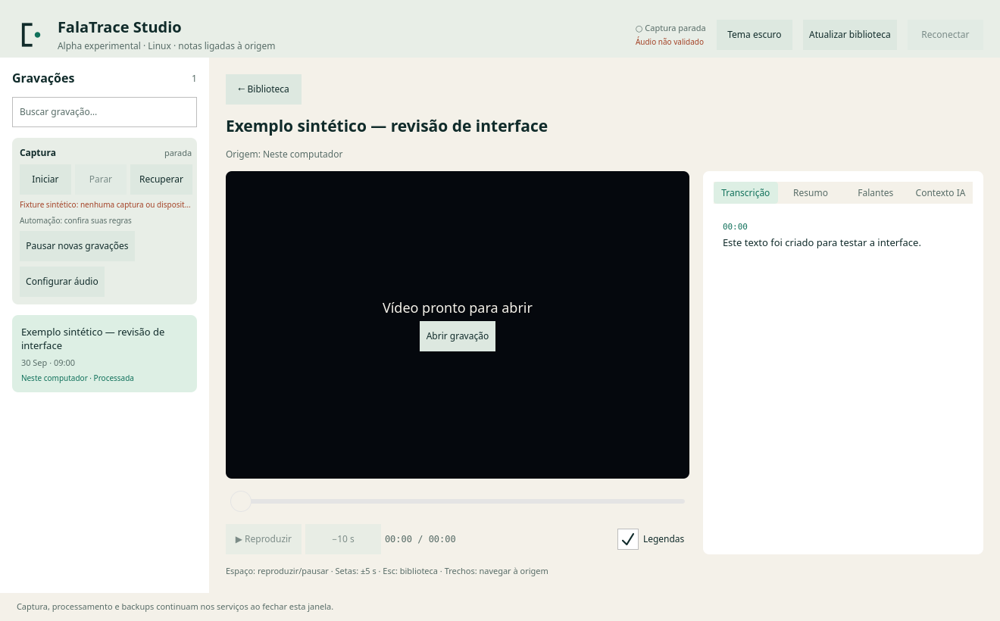

<picture>
  <source media="(prefers-color-scheme: dark)" srcset="docs/assets/falatrace-wordmark-dark.svg">
  
</picture>

# FalaTrace

Meeting notes for Linux that point back to the recording. You type short notes during the meeting. After it, the AI completes them with what was said, and every line it adds cites the moment of the recording it came from. Recording, transcription and notes run on your computer by default. FalaTrace is an experimental source alpha (0.2.0-alpha.14); see [evidence and limits](docs/EVIDENCE-AND-LIMITS.md).

<!-- studio-check: replace with a screenshot of the notes-first meeting page once the redesigned Studio lands -->


*The current Studio, with synthetic data. A notes-first redesign is in progress.*

## Install

You need Linux, Bun 1.4, FFmpeg and Git. Local processing also needs [whisper.cpp](https://github.com/ggml-org/whisper.cpp) and [Ollama](https://ollama.com), installed separately. On Ubuntu:

```sh
git clone https://github.com/caiolombello/falatrace.git && cd falatrace
bun install --frozen-lockfile --ignore-scripts
make install-cli
sudo apt install qt6-base-dev qt6-base-dev-tools qt6-declarative-dev libmpvqt-dev
make install-studio
```

Open **FalaTrace Studio** from the application menu, or run `recording-studio`. The setup assistant takes you to your first notes in a few minutes. <!-- studio-check --> Nothing records, uploads or downloads until you ask. Step by step: [quickstart](docs/QUICKSTART.md) ([português](docs/QUICKSTART.pt-BR.md)).

## What it does

- **Notes and templates.** A notepad next to the recording keeps the time of each line. The AI turns your notes into structured notes that follow a template (1:1, stand-up, postmortem, sales discovery and more, or your own). Your lines stay yours; AI lines are marked and cite the transcript.
- **Ask, with citations.** Ask about one meeting, a person, a client or the whole library. Answers cite the moments they come from. Use local Ollama, an API key (OpenAI, OpenRouter, Anthropic, Gemini and others), an ACP agent, your own subscription CLI (`claude`, `codex`, `gemini`, `opencode`) or Sign in with ChatGPT.
- **People, clients and actions.** People from confirmed speaker names and calendar guests, clients from your catalog, and the action items of every meeting in one list you can tick off.
- **Reminders and a brief.** A notification shortly before a calendar meeting, with what earlier meetings with the same people left open, and a button to record or skip it.
- **Share.** Send a meeting's notes to Obsidian, Notion, Slack or an AI app, after a preview.
- **Live transcript.** An optional preview of the transcript while the meeting runs.
- **Retention.** Keep the media, keep only the audio, or keep only the transcript once it is verified.
- **Review and export.** Correct the transcript and speaker names as revisions; the original stays. Export JSON, Markdown, SRT or WebVTT.

Details: [notes and templates](docs/NOTES-AND-TEMPLATES.md), [assistant](docs/ASSISTANT.md), [people, clients and actions](docs/PEOPLE-CLIENTS-ACTIONS.md), [reminders and live transcript](docs/REMINDERS-AND-LIVE.md), [sharing](docs/SHARING.md).

## Privacy

- **Local by default.** A new configuration transcribes with Whisper.cpp and writes notes with Ollama on this computer. Nothing is processed automatically until you turn it on.
- **You see every destination first.** Processing, questions and shares you start name the destination before anything leaves the computer, and ask for your consent when it does. A setting that picks an external provider applies to every recording until you change it.
- **Your data stays in private files.** Notes, conversations, people and action states are files only your user can read. Deleting a recording does not yet remove all of them; see [privacy and data](docs/PRIVACY.md).
- **Record with permission.** Confirm that the people in the call agree. Automatic call detection is opt-in and does not establish consent.

**Agents.** Local agents such as Claude Code, Codex and Gemini CLI can read bounded, cited context through the CLI (any processed recording, like any program you run) or a local MCP server (only the recordings you grant): [skill](skills/README.md), [agent access](skills/falatrace/references/agent-frames.md).

## Documentation

| Topic | Document |
| --- | --- |
| First use | [Quickstart](docs/QUICKSTART.md) · [Início rápido](docs/QUICKSTART.pt-BR.md) |
| Notes, templates, summaries | [NOTES-AND-TEMPLATES.md](docs/NOTES-AND-TEMPLATES.md) |
| Asking questions, providers, recipes | [ASSISTANT.md](docs/ASSISTANT.md) |
| People, clients, action items | [PEOPLE-CLIENTS-ACTIONS.md](docs/PEOPLE-CLIENTS-ACTIONS.md) |
| Reminders, brief, live transcript | [REMINDERS-AND-LIVE.md](docs/REMINDERS-AND-LIVE.md) |
| Obsidian, Notion, Slack, AI apps | [SHARING.md](docs/SHARING.md) |
| Where data lives, what leaves, deletion | [PRIVACY.md](docs/PRIVACY.md) |
| Every setting | [CONFIGURATION.md](docs/CONFIGURATION.md) · [example](docs/config.example.json) · [Studio settings](docs/ONBOARDING.md) |
| What is verified and what is not | [EVIDENCE-AND-LIMITS.md](docs/EVIDENCE-AND-LIMITS.md) · [compatibility](docs/COMPATIBILITY.md) |
| Review and export | [HUMAN-REVIEW-EXPORT.md](docs/HUMAN-REVIEW-EXPORT.md) |
| History and plans | [CHANGELOG.md](CHANGELOG.md) · [roadmap](docs/ROADMAP.md) |
| Building and testing | [DEVELOPMENT.md](docs/DEVELOPMENT.md) · [security](SECURITY.md) |

The landing page is in [Portuguese](https://caiolombello.github.io/falatrace/) and [English](https://caiolombello.github.io/falatrace/en/). The Studio follows the system language (Portuguese or English).

## Development

```sh
bun run typecheck && bun run desktop:check && bun run lint
bash scripts/test-offline.sh
bun run build
```

Tests run offline with a synthetic HOME; never plain `bun test`. The Studio journeys, release gates and harness rules are in [DEVELOPMENT.md](docs/DEVELOPMENT.md).

## License

MIT for code by Caio Barbieri ([LICENSE](LICENSE)); third-party terms in [THIRD-PARTY-NOTICES.md](THIRD-PARTY-NOTICES.md). The executable is `falatrace`; configuration, state and service names keep the older `recording-cli` identifiers ([compatibility](docs/COMPATIBILITY.md#migration-and-identifiers)).
